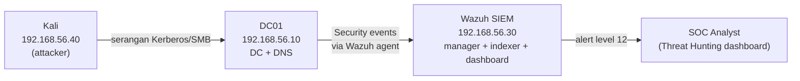

# Credential Access Detection Lab — Wazuh SIEM + Active Directory

Home SOC lab: mensimulasikan serangan **Credential Access** terhadap Active Directory dari Kali Linux, lalu membangun dan memvalidasi **custom detection rule** di Wazuh SIEM, dipetakan ke **MITRE ATT&CK**.

Proyek ini bukan sekadar "pasang SIEM". Tiap teknik dikerjakan dengan metodologi SOC penuh: **serangan nyata → cek baseline rule bawaan → tulis custom rule → validasi di dashboard → tuning false positive / dokumentasikan keterbatasan.**

---

## Ringkasan

Tiga teknik Credential Access dideteksi end-to-end, dengan tingkat kerumitan rule yang naik bertahap:

| # | Teknik | MITRE ATT&CK | Event Windows | Tipe detection rule | Rule ID |
|---|--------|--------------|---------------|---------------------|---------|
| 1 | Kerberoasting | T1558.003 | 4769 (TGS request) | Match + 2 tuning FP | 100100 / 100101 / 100110 |
| 2 | AS-REP Roasting | T1558.004 | 4768 (TGT request) | Match single-field | 100200 |
| 3 | Password Spraying | T1110.003 | 4625 (logon failure) | **Frequency correlation** | 100300 |

Tiap rule terbukti memicu alert **level 12** terhadap serangan nyata, dan terverifikasi muncul di dashboard Wazuh.

---

## Arsitektur Lab

Jaringan host-only VirtualBox `192.168.56.0/24`:

| Host | Peran | IP |
|------|-------|-----|
| **DC01** (Windows Server 2022) | Domain Controller + DNS, domain `corp.nusantara.lab` | 192.168.56.10 |
| **Wazuh 4.14** (Ubuntu, all-in-one) | SIEM — manager, indexer, dashboard | 192.168.56.30 |
| **Kali** | Penyerang (impacket, NetExec) | 192.168.56.40 |



**Pipeline deteksi:** event lahir di DC01 → Wazuh agent forward ke manager → decoder + rule engine → alert ditulis ke `alerts.json` → indexer → dashboard.

**Konsep kunci yang dipakai berulang:** sebuah event dicocokkan ke **satu** rule final (yang paling spesifik). Rule **level 0** = event sengaja di-drop dari indeks alert (dipakai untuk membungkam noise). Menaikkan level sebuah event = "mengangkat" event yang tadinya tak terlihat menjadi alert.

---

## Teknik 1 — Kerberoasting (T1558.003)

### Konsep
Penyerang dengan satu kredensial domain yang valid meminta **service ticket (TGS)** untuk akun layanan ber-SPN. Tiket di-enkripsi dengan hash NTLM akun layanan, sehingga bisa di-crack offline. Indikatornya: TGS request (event **4769**) dengan enkripsi lemah **RC4 (0x17)** ke SPN milik **akun user** (bukan akun mesin).

### Serangan
```bash
impacket-GetUserSPNs -request corp.nusantara.lab/asetiawan:'Autumn2024Batu!' -dc-ip 192.168.56.10
```
Target: service account `svc-sql` (SPN `MSSQLSvc/sql01.corp.nusantara.lab:1433`). Hasil: hash `$krb5tgs$23$*svc-sql...` terekstrak. *(Crack offline: hashcat mode `-m 13100`.)*

### Baseline — detection gap
Event 4769 **masuk** Wazuh, tapi hanya terpicu rule bawaan **60106 level 3** ("Windows Logon Success"), MITRE hanya "Valid Accounts". **Serangan lolos tanpa alert bernilai.**

### Custom rule
```xml
<rule id="100100" level="12">
  <if_sid>60106</if_sid>
  <field name="win.eventdata.ticketEncryptionType">0x17</field>
  <field name="win.eventdata.serviceName" negate="yes">\$$</field>
  <description>Kerberoasting terdeteksi: TGS RC4 (0x17) untuk SPN $(win.eventdata.serviceName)</description>
  <mitre><id>T1558.003</id></mitre>
  <group>kerberoasting,pci_dss_10.2.4,</group>
</rule>
```
**Logika:** parent 4769 + enkripsi RC4 + `serviceName` yang **bukan** akun mesin (`negate` pada pola `\$$`, karena akun mesin berakhiran `$`).

### Tuning false positive
Dua rule peredam (level 0 = tidak masuk indeks alert):

```xml
<rule id="100101" level="0">
  <if_sid>100100</if_sid>
  <field name="win.eventdata.serviceName">krbtgt</field>
  <description>Kerberoasting FP: TGS krbtgt (aktivitas Kerberos normal, diabaikan)</description>
</rule>

<rule id="100110" level="0">
  <if_sid>60106</if_sid>
  <field name="win.eventdata.serviceName">\$$</field>
  <description>Noise: 4769 akun mesin (komunikasi Kerberos rutin, diabaikan)</description>
</rule>
```

**Angka before/after:** dari 12 event 4769 dalam 24 jam, **11 (92%)** adalah akun mesin/noise, hanya 1 svc-sql. Setelah rule 100110: **0 alert noise** akun mesin, svc-sql tetap level 12. Verifikasi: `rule.id:60106 and serviceName:*$` → 0 hits.

### Detection gap yang jujur (lessons learned)
Request Kerberoasting dari Kali **terbukti di-log** di DC (Event Viewer: Client Address `::ffff:192.168.56.40`, svc-sql, 0x17), tetapi event itu **tidak konsisten ter-forward** ke Wazuh pada skala lab — alert yang terpicu justru dari request DC lokal (`::1`). Bukan rate-limit (`ossec.log` bersih). **Kesimpulan:** rule-nya benar; celah ada di forwarding agent→SIEM. Dicatat sebagai lessons-learned: *validasi di source tetap perlu, dan memantau kesehatan pipeline adalah bagian kerja SOC.*

---

## Teknik 2 — AS-REP Roasting (T1558.004)

### Konsep
Akun dengan flag **`DoesNotRequirePreAuth`** aktif bisa diminta **TGT (event 4768)** tanpa autentikasi pre-auth. Bagian tiket di-enkripsi dengan hash akun → bisa di-crack offline. Indikator utama: 4768 dengan **`preAuthType = 0`** (cerminan langsung misconfig; di domain sehat nyaris nol, jadi false positive minim).

### Serangan
```bash
impacket-GetNPUsers -dc-ip 192.168.56.10 -request -no-pass -usersfile users.txt corp.nusantara.lab/
```
Target: `rramadhan` (`DoesNotRequirePreAuth=True`). Hasil: hash `$krb5asrep$23$rramadhan@...` terekstrak. *(Crack offline: hashcat mode `-m 18200`.)*

### Misteri baseline — dan pemecahannya
Event 4768 **tidak pernah muncul** di dashboard (0 dari 24 jam) **padahal terbukti lahir** di DC (Event Viewer: rramadhan, PreAuthType 0, enc 0x17). Sementara 4769 masuk normal.

**Akar masalah (hipotesis yang terbukti benar):** 4768 sukses diterima manager tapi **jatuh di level 0** (informational) — tidak ditulis ke `alerts.json`, tidak terindeks, sehingga tidak muncul di Discover. Event-nya **tidak pernah hilang**; ia hanya tak pernah diangkat jadi alert. Custom rule mengangkatnya ke level 12 → terbukti.

### Custom rule
```xml
<rule id="100200" level="12">
  <if_sid>60103</if_sid>
  <field name="win.eventdata.preAuthType">^0$</field>
  <description>AS-REP Roasting terdeteksi: TGT tanpa pre-auth untuk $(win.eventdata.targetUserName)</description>
  <mitre><id>T1558.004</id></mitre>
  <group>asrep_roasting,pci_dss_10.2.4,</group>
</rule>
```
**Logika:** parent **60103** (event 4768) + `preAuthType = 0`. Catatan implementasi: nama field memakai lowercase `preAuthType`, dan `if_sid` di sini **berbeda** dari Kerberoasting (60103 untuk 4768, bukan 60106 untuk 4769) — anchor harus cocok dengan event ID targetnya.

### Validasi
`rule.id:100200` → 1 hit, agent DC01, rramadhan, level 12, MITRE T1558.004. Misteri "event hilang" resmi terjawab: event sampai manager sejak awal, hanya tak terindeks hingga rule menaikkan levelnya.

---

## Teknik 3 — Password Spraying (T1110.003)

### Konsep
Kebalikan dari brute-force klasik: **satu password** dicoba ke **banyak akun** untuk menghindari lockout. Signature-nya bukan satu event, melainkan **pola**: banyak akun berbeda gagal login, dari satu sumber, dalam window waktu singkat.

### Serangan
```bash
nxc smb 192.168.56.10 -u spray_users.txt -p 'Password123!' --continue-on-success
```
11 akun domain di-spray dengan satu password lemah → semua `STATUS_LOGON_FAILURE` (skenario murni-gagal). Event yang lahir: **4625** (NTLM/SMB logon failure).

### Tantangan deteksi — kenapa rule ini berbeda
Event 4625 **sudah** punya rule bawaan **60122 level 5** (sudah terindeks — tidak seperti kasus AS-REP). Jadi masalahnya bukan "event hilang". Tantangannya: **satu 4625 itu normal** (orang salah password tiap hari). Membuat alert per-event = banjir false positive. Yang menandakan spraying adalah **pola frekuensi**, bukan event tunggal.

Solusinya **correlation rule berbasis frekuensi** — satu tingkat lebih kompleks dari dua rule sebelumnya:

```xml
<rule id="100300" level="12" frequency="8" timeframe="60">
  <if_matched_sid>60122</if_matched_sid>
  <field name="win.eventdata.ipAddress">\.+</field>
  <description>Password Spraying terdeteksi: banyak akun gagal login dari satu sumber dalam waktu singkat</description>
  <mitre><id>T1110.003</id></mitre>
  <group>password_spraying,authentication_failures,pci_dss_10.2.4,</group>
</rule>
```

**Logika tiap atribut:**
- `frequency="8"` + `timeframe="60"` — picu hanya jika **8 kegagalan dalam 60 detik**. Window waktu inilah yang membedakan "spraying" dari "8 orang salah password sepanjang hari".
- `if_matched_sid 60122` — menghitung berapa kali **rule** 60122 terpicu (bukan event mentah); inilah yang mengaktifkan mesin frekuensi.
- `field win.eventdata.ipAddress \.+` — memastikan event punya IP sumber.

Hasil: 11 kegagalan masuk → rule memicu **satu** alert korelasi level 12 (bukan 11 alert). Noise level 5 tetap ada di bawah; analis memfilter yang level 12 → sinyal high-fidelity muncul, alert fatigue ditekan.

### Kendala yang dipecahkan (catatan engineering)
Rencana awal memakai helper tag `<same_source_ip/>` + `<different_user/>`, tapi **tidak jalan**: decoder tidak memetakan field ke `srcip`/`dstuser` — user & IP hanya hidup di `win.eventdata.targetUserName` / `win.eventdata.ipAddress`. Diverifikasi dengan membaca JSON alert 60122 (field `srcip`/`dstuser` kosong). Solusi: ganti ke field-matching langsung ke `win.eventdata.ipAddress`.

### Known limitation & future work (detection gap)
Versi field-matching ini **kehilangan** presisi strict "same-IP + different-user". Konsekuensinya: **brute-force** (banyak kegagalan ke *satu* akun, T1110.001) juga akan ikut memicu rule ini. Di lab (satu penyerang) tidak masalah, tapi didokumentasikan sebagai keterbatasan.
**Future work:** custom decoder untuk mengisi `srcip`/`dstuser`, lalu pakai `<same_source_ip/>` + `<different_user/>` strict agar spraying (.003) dan brute-force (.001) terpisah.

### Validasi
`rule.id:100300` → 1 hit, `firedtimes:1`, `frequency:8`. Field `previous_output` merangkum 8 event 4625 dari akun berbeda, semua dari 192.168.56.40 — bukti visual bahwa ini korelasi, bukan match tunggal.

---

## Metodologi (yang dipakai untuk ketiga teknik)

1. **Mulai dari skenario, bukan tool** — pahami teknik ATT&CK dulu, baru pilih alat.
2. **Cek baseline** — jalankan serangan, lihat apa yang ditangkap (atau dilewatkan) rule bawaan. Dokumentasikan detection gap.
3. **Tulis custom rule** — anchor ke event yang tepat, match indikator spesifik.
4. **Validasi sebelum restart** — `wazuh-analysisd -t` menangkap error XML sebelum merusak engine.
5. **Buktikan end-to-end** — serang ulang, konfirmasi alert di dashboard.
6. **Tuning / dokumentasikan keterbatasan** — kurangi false positive, dan jujur soal apa yang masih lolos.

---

## Catatan operasional (reproducibility)

- **Validasi ruleset sebelum restart:** `sudo /var/ossec/bin/wazuh-analysisd -t`
- **Restart manager:** `sudo systemctl restart wazuh-manager` lalu tunggu ~90 detik
- **Monitor alert real-time:** `sudo tail -f /var/ossec/logs/alerts/alerts.json | grep -a <rule_id>`
- **Cek manager hidup (port API):** `sudo ss -tlnp | grep 55000`
- Semua custom rule berada di `/var/ossec/etc/rules/local_rules.xml`, group `windows,windows_security,attack`.
- Audit policy DC01 yang dibutuhkan: Kerberos Authentication Service, Kerberos Service Ticket Operations, Logon, Credential Validation, **Audit Logon Failure** (untuk 4625).

---

## Status & roadmap

**Selesai:** Kerberoasting (T1558.003), AS-REP Roasting (T1558.004), Password Spraying (T1110.003) — ketiganya attack → detect → validate.

**Berikutnya (opsional):** DCSync (T1003.006), Golden Ticket, Pass-the-Hash; incident report + playbook per teknik; active response (auto-disable akun saat deteksi); SCA / CIS hardening.
